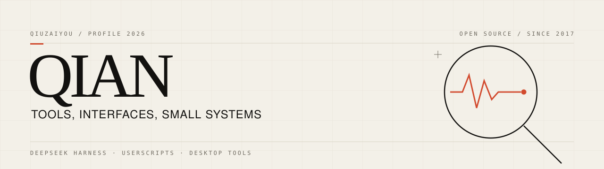

  <picture>
    <source media="(prefers-color-scheme: dark)" srcset="./assets/banner-dark.svg">
    
  </picture>

## 现在 / NOW

**DeepSeek Harness 插件组**：给 DSH 的侧栏、工作区和输入框补上缺失的那一层。三个插件都在持续维护。

- **[dsh-panel-control](https://github.com/QIUZAIYOU/dsh-panel-control)**：给侧栏入口排序、隐藏、分组和折叠。自动分类会跳过手动调整过的入口，下次分类时不会再放回去。
- **[dsh-workspace-control](https://github.com/QIUZAIYOU/dsh-workspace-control)**：在侧栏里移动、重建、合并、重命名和删除工作区。
- **[dsh-composer-rewind](https://github.com/QIUZAIYOU/dsh-composer-rewind)**：找回输入框的历史：文字、附件、引用、命令和当时的 DSH 配置。

## 作品 / SELECTED

**[Bilibili-Adjustment](https://github.com/QIUZAIYOU/Bilibili-Adjustment)** · `TypeScript` `Userscript` · 18 stars 
B 站播放页与动态页的界面调整脚本，装进浏览器脚本管理器就能用。

**[Stylish](https://github.com/QIUZAIYOU/Stylish)** · `Stylus` · 23 stars 
为常用网站写的一组自定义样式，配合 Stylish / Stylus 扩展使用。

## 工具 / TOOLBOX

`TypeScript` `JavaScript` `Vue` `Python` `Rust` `Java` 
`Node.js` `Tauri` `GitHub Actions` `Stylus`

---

QIUZAIYOU · 2026
